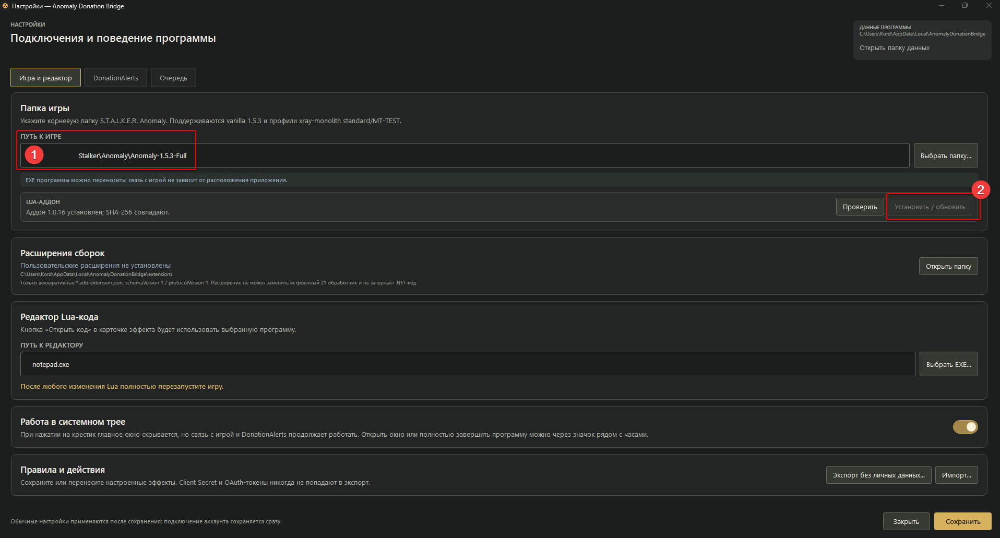
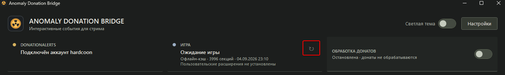

# Anomaly Donation Bridge

Донаты **DonationAlerts** и **DonateX** запускают настроенные эффекты в S.T.A.L.K.E.R. Anomaly. Встроенный **«Чат зрителей»** объединяет **YouTube, Twitch и VK Видео Live**; сообщения со всех трёх площадок могут участвовать в голосованиях.

**[Скачать программу](https://github.com/hardcoon/anomaly-donation-bridge/releases/latest)** · [Изменения 1.5.2](docs/RELEASE_1.5.2_RU.md)

Windows x64 · Anomaly 1.5.3 · Программа **1.5.2** · Аддон **1.0.196** · 77 файловых шаблонов

## Инструкции

- **[Обновление и особенности установки](docs/INSTALL_RU.md)**
- **[Настройка эффектов и голосований](docs/USAGE_RU.md)**
- **[Чат зрителей: YouTube, Twitch и VK Видео Live](docs/VIEWER_CHAT_RU.md)**
- **[Авто-формирование голосований](docs/VOTING_AUTOMATIC_RU.md)**
- **[Отдельные окна чата, голосований и истории](docs/DETACHED_WINDOWS_RU.md)**
- **[Список всех шаблонов](docs/TEMPLATES_RU.md)**
- **[Решение проблем](docs/TROUBLESHOOTING_RU.md)**
- **[Исходники и самостоятельная сборка](docs/BUILD_RU.md)**

## Перед установкой

Для части шаблонов нужны [Modded Exes — xray-monolith](https://github.com/themrdemonized/xray-monolith/releases/latest). Подходят Standard и MT. Установите полный пакет с DLL по инструкции автора.

## Первый запуск

### 1. Распакуйте программу

Распакуйте ZIP из **Assets** на странице релиза в отдельную папку. Запустите `AnomalyDonationBridge.exe`.

Рядом с EXE должны остаться `addon-package`, `effects` и скрытая папка `_internal`.

### 2. Установите аддон в игру

1. Закройте Anomaly.
2. Откройте **Настройки → Игра и редактор**.
3. Укажите корень игры — папку с `fsgame.ltx` и `bin`.
4. Нажмите **«Установить / обновить аддон и эффекты»**.

После установки полностью перезапустите игру.

Скриншот: выбор папки и установка

### 3. Загрузите каталог игры

1. В Anomaly **загрузите любое сохранение** и снимите игру с паузы.
2. В программе нажмите **↻** рядом со статусом игры.
3. Вернитесь в игру и дождитесь окончания сканирования. Можно продолжать играть; главное — не ставить игру на паузу.

Скриншот: обновление каталога

### 4. Настройте первый эффект

1. Во вкладке **Шаблоны** выберите эффект и нажмите **«Настроить»**.
2. Задайте параметры и нажмите **«Сохранить и закрыть»**.
3. Нажмите **«В пользовательские»** и задайте название.
4. Во вкладке **Пользовательские шаблоны** назначьте условие кнопкой **«+ Сумма»**.
5. Нажмите **«В активные»**, затем проверьте эффект кнопкой **«Тест»** на копии сохранения.

### 5. Подключите сервис донатов

В **Настройки → Интеграция** подключите **[DonationAlerts](docs/DONATIONALERTS_SETUP_RU.md)** или **[DonateX](docs/DONATEX_SETUP_RU.md)**. Их можно использовать одновременно.

Для сообщений зрителей откройте **[«Чат зрителей»](docs/VIEWER_CHAT_RU.md)** в левой панели, раскройте **«Подключения»** и укажите эфир YouTube или канал Twitch / VK Видео Live. Публичные чаты читаются анонимно: аккаунт и свой API-ключ не нужны. Подключение через **[YouTube API](docs/YOUTUBE_CHAT_SETUP_RU.md)** в настройках осталось необязательным резервным способом.

### 6. Включите обработку

Включите **«Обработку донатов»** в главном окне. Донаты будут запускать подходящие активные шаблоны.

Для голосов со всех площадок отметьте источник **«Чат зрителей»** в настройках голосования, затем нажмите **«Старт»** в его шапке. Переключатель **«Обработка донатов»** можно оставить выключенным. [Настройка голосов из чата](docs/USAGE_RU.md#голоса-из-чата-зрителей).

Лицензия — [Hardcoon No-Resale License 1.0](LICENSE): бесплатное использование, изменение и бесплатное распространение. Перепродажа и включение в платный сервис требуют письменного разрешения Hardcoon.
