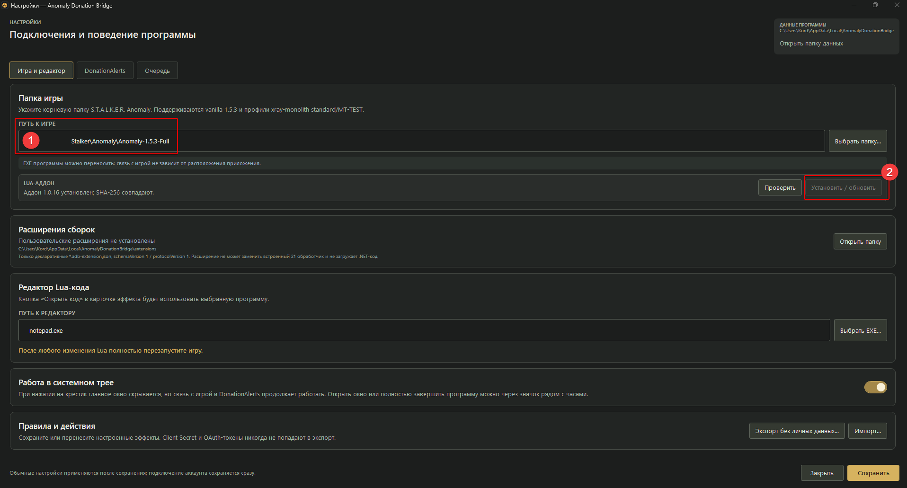
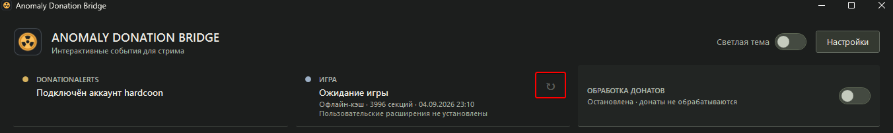

# Anomaly Donation Bridge

Донаты **DonationAlerts** и **DonateX** запускают настроенные эффекты в S.T.A.L.K.E.R. Anomaly.

**[Скачать программу](https://github.com/hardcoon/anomaly-donation-bridge/releases/latest)** · [Изменения 1.3.3](docs/RELEASE_1.3.3_RU.md)

Windows x64 · Anomaly 1.5.3 · Программа **1.3.3** · Аддон **1.0.135**

## Инструкции

- **[Установка и обновление](docs/INSTALL_RU.md)** — установка аддона, обновление программы, особенности MO2/GAMMA и подготовка напарника-мутанта V2.
- **[Настройка эффектов](docs/USAGE_RU.md)** — суммы и валюты донатов, порядок выполнения, профили и горячие клавиши.
- **[Голосования](docs/USAGE_RU.md#голосования)** — команды, запуск рулетки, вывод в OBS и прогресс в игре.
- **[Все шаблоны](docs/TEMPLATES_RU.md)** — краткие описания и важные особенности всех 63 шаблонов.
- **[Решение проблем](docs/TROUBLESHOOTING_RU.md)** — что делать, если игра не подключается, каталог не обновляется или донаты не запускают эффекты.

## Перед установкой

Для части шаблонов нужны [Modded Exes — xray-monolith](https://github.com/themrdemonized/xray-monolith/releases/latest). Подходят Standard и MT; MT не обязателен. Устанавливайте полный пакет движка по инструкции автора, включая его DLL.

**MO2 и GAMMA не обязательны.** Аддон и эффекты можно установить напрямую в корень игры, оставив поле **«Папка мода MO2»** пустым.

Для **напарника-мутанта V2** выполните дополнительную подготовку из раздела «Установка и обновление».

## Первый запуск

### 1. Распакуйте программу

Скачайте ZIP из **Assets** на странице релиза и распакуйте целиком в отдельную папку. Запустите `AnomalyDonationBridge.exe`.

Рядом с EXE должны остаться `addon-package`, `effects` и скрытая папка `_internal`.

### 2. Установите аддон в игру

1. Закройте Anomaly.
2. Откройте **Настройки → Игра и редактор**.
3. Укажите корень игры — папку с `fsgame.ltx` и `bin`.
4. Нажмите **«Установить / обновить аддон и эффекты»**.

Кнопка устанавливает игровой аддон и файлы шаблонов. После установки полностью перезапустите игру.

Скриншот: выбор папки и установка

### 3. Загрузите каталог игры

1. В Anomaly **загрузите сохранение** и снимите паузу.
2. В программе нажмите **↻** рядом со статусом игры.
3. Вернитесь в игру и дождитесь окончания сканирования.

Скриншот: обновление каталога

### 4. Настройте первый эффект

1. Во вкладке **Шаблоны** выберите эффект и нажмите **«Настроить»**.
2. Задайте параметры и нажмите **«Сохранить и закрыть»**.
3. Нажмите **«В пользовательский шаблон»** и задайте название.
4. Во вкладке **Пользовательские шаблоны** назначьте условие кнопкой **«+ Сумма»**.
5. Нажмите **«В активные»**, затем проверьте эффект кнопкой **«Тест»** на копии сохранения.

### 5. Подключите сервис донатов

**[Настройка интеграции](docs/INTEGRATIONS_RU.md)** — подключите DonationAlerts, DonateX или оба сервиса сразу.

### 6. Включите обработку

Включите **«Обработку донатов»** в верхней части главного окна. Новые донаты будут запускать активные варианты с подходящими условиями суммы и валюты.

Лицензия — [Hardcoon No-Resale License 1.0](LICENSE): бесплатное использование, изменение и бесплатное распространение. Перепродажа и включение в платный сервис требуют письменного разрешения Hardcoon.
