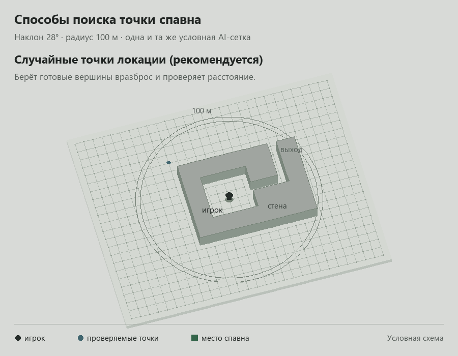
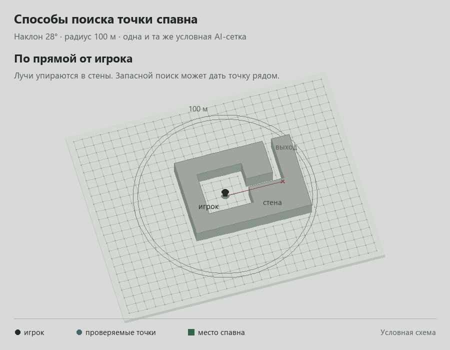
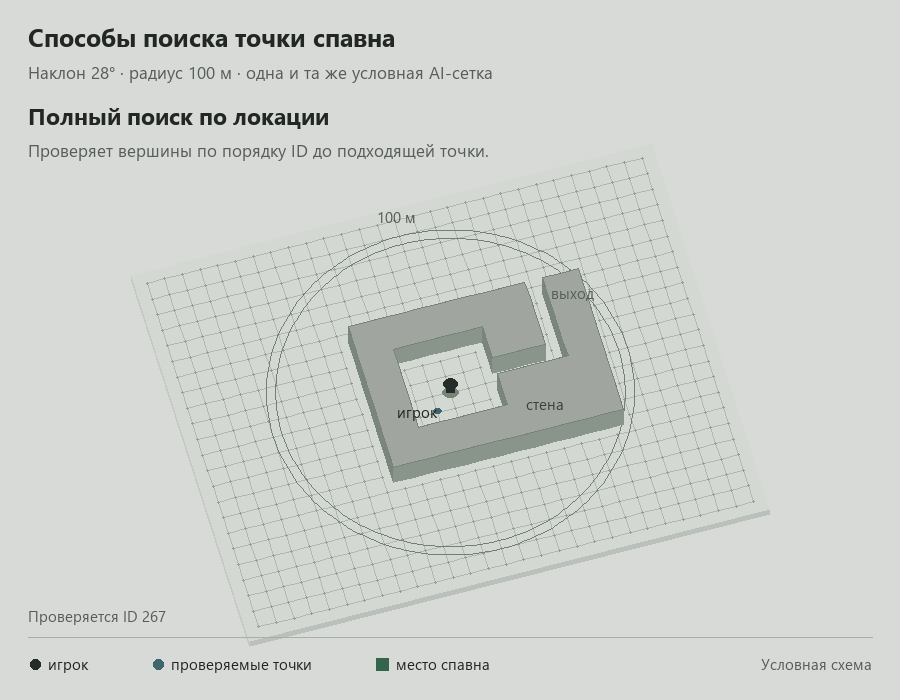
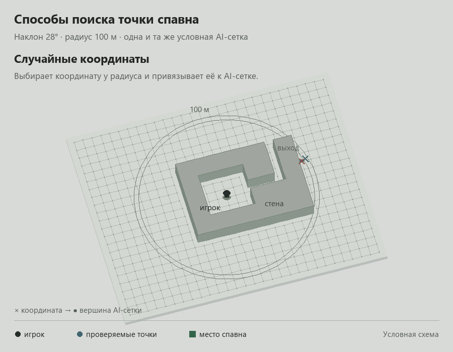

# Настройка эффектов и голосований

[← Первый запуск](../README.md#первый-запуск) · [Шаблоны](TEMPLATES_RU.md) · [Решение проблем](TROUBLESHOOTING_RU.md)

## Шаблоны и активные варианты

- **Шаблоны** — готовые эффекты для настройки.
- **Пользовательские шаблоны** — ваши сохранённые варианты с параметрами и ценами.
- **Активные** — варианты, запускаемые донатами. Их изменения не затрагивают пользовательские шаблоны.

Меню шаблона открывается кнопкой **«⋯»** или правым кликом по карточке либо строке.

## Сброс параметров героя

В настройках шаблона **«Временно изменить параметры героя»** кнопка **«Сбросить параметры к базовым»** останавливает эффект и возвращает прыжок, скорость и переносимый вес к значениям конфигов установленной игры. Подходит для старых сохранений с застрявшими параметрами. После подтверждения сброса сохраните игру, чтобы закрепить очистку старых записей ADB.

## Поиск места появления NPC и мутантов

Параметр **«Способ поиска места появления»** доступен в четырёх шаблонах:

- **«Заспавнить мутантов»**;
- **«Заспавнить NPC»**;
- **«Случайные мутанты (без сквада)»**;
- **«Случайные NPC (без сквада)»**.

Радиус появления — до **500 м**. На схемах для примера задано 100 м. Линии показывают этапы поиска точки; AI-сетка и скорость анимации условные.

Поиск выполняется порциями. Обычное движение сохраняет его прогресс; перед спавном расстояние проверяется от текущей позиции игрока. Повторная проверка незавершённого поиска не запускает заново глобальную паузу. Если подходящих точек нет после завершения поиска, событие отклоняется с указанием причины.

<strong>Случайные точки локации (рекомендуется)</strong>

Метод по умолчанию. Проверяет готовые вершины AI-сетки вразброс. Запасной вариант — ближайшая к заданному радиусу из проверенных точек, не ближе 10 м от игрока.

<strong>По прямой от игрока</strong>

Прежний метод: ищет по прямым направлениям, которые могут упираться в препятствия. При неудаче может выбрать точку рядом с игроком, вплоть до его позиции.

<strong>С обходом препятствий</strong>

Ищет через связанные вершины AI-сетки, проходы и повороты.

<strong>Полный поиск по локации</strong>

Перебирает вершины по порядку ID до нахождения подходящих точек. На большой AI-сетке может работать дольше.

<strong>Случайные координаты</strong>

Выбирает координаты на заданной дистанции, привязывает их к AI-сетке и повторно проверяет расстояние.

## Суммы и валюты

**«+ Сумма»** добавляет цену: **`=`** — точная сумма, **`≥`** — от указанной суммы. Валюта должна совпадать; входящие донаты не конвертируются.

**Авторасчёт валют** создаёт цены по курсу Банка России. Шестерёнка задаёт используемые валюты; выбор сохраняется. Подтверждение расчёта заменяет все прежние цены варианта. Обычное сохранение меняет только выбранное условие.

**«Экспорт для стрима…»** сохраняет TXT: `Название: 372 RUB, от 500 RUB`.

## Очередь и порядок шагов

При загрузке, смерти героя или диалоге эффекты ждут в очереди. Очередь сохраняется после перезапуска программы.

В группе одинаковых сумм перетаскивайте ручку слева от шага. Новый порядок применяется к следующим донатам; принятые события сохраняют прежний.

**«Выполнять строго по порядку»** — следующий шаг группы ждёт подтверждения запуска предыдущего. Длительные эффекты могут работать одновременно. Другие группы продолжают работу.

**«Задержка между срабатываниями эффектов»** в раскрытой группе заменяет глобальную паузу между её шагами. По умолчанию — 1 секунда, 0 — без дополнительной паузы. Значение сохраняется при Enter или уходе из поля и применяется к новым донатам. Уже принятая очередь сохраняет свой интервал после перезапуска программы.

Общая пауза между отдельными донатами задаётся в **Настройки → Очередь**. Пауза отдельного шаблона не блокирует остальные.

## История, тест и повтор

- **История** — результаты и причины ожидания событий.
- **«Тест»** — проверка эффекта в игре без подключения донатов.
- **«Запустить от имени донатера»** в меню шаблона — ручной ввод ника и текста описания. Запуск проходит через очередь и сохраняется в истории с указанными данными.
- **Shift** выделяет диапазон строк, **Ctrl** — отдельные строки. Правый клик открывает меню действий в обычном и компактном режимах; клик по уже выделенной строке сохраняет выделение.
- **«Повторить»** — ручной повтор завершённых событий, доступный и при выключенной обработке донатов.
- **«Применить мгновенно»** — только для выделенных событий, ещё ожидающих в очереди. Они получают приоритет без ожидания пауз и предыдущих шагов группы. Готовность игры, каталог и безопасная зона проверяются как обычно; команды отправляются по одной с ожиданием ответа игры. Завершённые события не повторяются.
- **`uncertain`** — подтверждение потеряно. Перед ручным повтором проверьте результат в игре; автоматически эффект не повторяется.

## Профили и горячие клавиши

**«Профили»** переключают активные и пользовательские шаблоны. Подключения, история и очередь общие.

В **Настройки → Горячие клавиши** назначаются переключение обработки, повтор доната и запуск шаблона по номеру. Сочетания работают поверх игры; назначение варианту также доступно через **⋯**.

## Голосования

1. Создайте голосование и добавьте команды с активными шаблонами. Можно через меню шаблона: **⋯ → Добавить в голосование → название**.
2. Задайте сумму, время или сочетание **И / ИЛИ**.
3. Включите голосование. Одновременно активно только одно.

Команда в донате определяет участника, доля суммы — шанс победы. **Тестовый взнос** пополняет голосование без обычного эффекта доната.

В **«Голосование: Общие настройки»** задаются автозапуск рулетки, применение победителя, запуск следующего голосования и очередь. Изменения сохраняются автоматически.

В ручном режиме подтвердите эффект в окне рулетки. В автоматическом он поступает в очередь после её закрытия. Сумма и победитель записываются в историю для повтора без нового розыгрыша.

### Голоса из чата YouTube

Подключите чат по [инструкции подключения](YOUTUBE_CHAT_SETUP_RU.md). В правой колонке голосования выберите источники: **«Описания доната»**, **«Чата YouTube»** или оба. Новые поля сохраняются автоматически и наследуются при создании следующего голосования.

- Один YouTube-аккаунт даёт один голос за раунд. Вес задаётся суммой в валюте голосования, по умолчанию — **1**. Реальные донаты учитываются каждый по своей сумме.
- Повтор той же команды не добавляет вес. Если разрешена смена голоса, другая команда переносит первоначальный вес к новому варианту. По умолчанию смена выключена.
- Команды распознаются без учёта регистра. Повтор одной команды в сообщении считается один раз; несколько разных команд в одном сообщении не принимаются.
- Изменение веса действует на новых участников. Уже принятый голос сохраняет свой вес и валюту.
- Перезапуск, переподключение и выключение/включение текущего голосования не сбрасывают голоса. Новый раунд или **«Сбросить прогресс»** разрешает голосовать снова. Старые сообщения чата не переносятся в следующий раунд.

Для приёма голосов должны быть включены текущее голосование и **«Обработка»** в главном окне. Сумма, таймер и условия **И / ИЛИ** работают с общим весом донатов и чата.

Если вариант должен только объявить результат, добавьте пользовательский шаблон на основе **«Отправить сообщение в КПК»** и назовите его, например, **«Ничего не делать»**. В КПК появится **Название голосования: название победившего шаблона**.

### OBS и HUD в игре

**«Вывести окно OBS»** открывает одно прозрачное масштабируемое окно **«ADB — Голосования OBS»** для всех голосований. Оно показывает активное голосование и автоматически переключается на следующее. Выбор страницы в редакторе не меняет захват. Если активного голосования нет, содержимое скрывается, а окно захвата остаётся.

В **Голосование → Общие настройки → Прогресс в игре и OBS** выберите **Проценты**, **Сумма** или **Таймер** и показ списка команд. HUD и окно OBS используют одинаковые настройки; сумма отображается в валюте голосования. У кольца OBS прозрачный центр и разделители секторов, результат находится под ним.

При уменьшении окна OBS кольцо и прогресс-бар скрываются. Название голосования, таймер и список команд с названиями эффектов и значениями остаются видимыми.

**«Редактировать положение»** открывает образец игрового HUD на рабочем столе: переместите его и нажмите **«Применить»**.

## Безопасная зона и исключения

**Настройки → Безопасная зона:** добавьте локации, выберите все или отдельные типы эффектов, включите настройку и нажмите **«Сохранить»**.

Заблокированное событие пропускается или ждёт выхода с локации — по выбранному режиму. Правила действуют на донаты, тесты, повторы и победителей голосования. Уже работающие эффекты продолжаются.

**Настройки → Исключения:** запрет секций для выбора, сохранённых вариантов и случайной выдачи. Добавьте ID вручную или выберите событие в истории → **«Добавить в исключения»**.

## Общие настройки

- **Колесо фортуны** — случайный активный шаблон после простоя без донатов; `0` отключает. Работает независимо от переключателя обработки.
- **Служебные сохранения ADB** — до/после эффектов, по умолчанию хранится 50. Обычные и быстрые сохранения не удаляются.
- **Работа в системном трее** — крестик скрывает окно; полный выход через значок в трее.
- **Принудительный перезапуск при вылете** — восстановление программы в фоне после сбоя.
- **Скрывать недоступные секции** — скрытие небезопасных секций. Если отключено, они видны, но заблокированы.

## Поиск и оформление

При уменьшении окна включается компактная компоновка с боковой панелью. Категории расположены в два ряда, поиск — справа на второй строке. Окно можно уменьшить до **640×520**; при увеличении возвращается обычная компоновка.

**Лупа** или **Ctrl+F** — поиск в активных, пользовательских и исходных шаблонах с учётом категории. **Esc** или крестик сбрасывают поиск.

Над списками включаются **«Описание»**, компактный вид или сетка; выбор сохраняется для каждой вкладки. **«Тема»** меняет цветовой акцент и фон.
