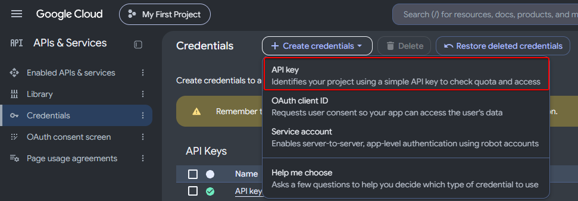
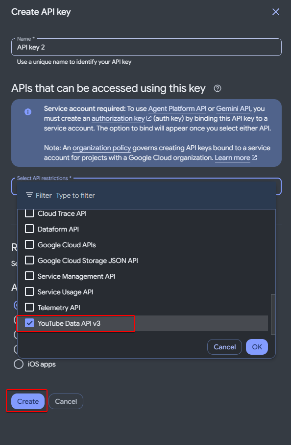
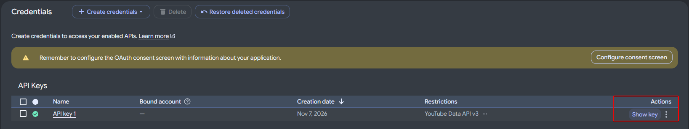

# Подключение чата YouTube

[← Первый запуск](../README.md#5-подключите-сервис-донатов)

Ключ API сохраняется один раз. Для следующего эфира достаточно заменить ссылку на трансляцию.

### Ключ API — один раз

1. В [Google Cloud](https://console.cloud.google.com/projectselector2/home/dashboard) создайте или выберите проект. Включите для него [YouTube Data API v3](https://console.cloud.google.com/apis/library/youtube.googleapis.com).
2. Откройте [APIs & Services → Credentials](https://console.cloud.google.com/apis/credentials), нажмите **Create credentials → API key**.

Скриншот: создание ключа

3. В **API restrictions** разрешите только **YouTube Data API v3**. Для настольной программы оставьте **Application restrictions → None** и нажмите **Create**. Если ключ уже создан, откройте его настройки и сохраните эти ограничения.

Скриншот: выбор YouTube Data API v3

4. Нажмите **Show key**, скопируйте ключ. В ADB откройте **Настройки → Интеграция → Чат YouTube**, вставьте его и нажмите **«Сохранить ключ»**. Ссылка на эфир на этом шаге не нужна.

Скриншот: где скопировать ключ

Ключ хранится зашифрованным на этом компьютере и не включается в экспорт настроек. Не публикуйте его и не показывайте на стриме. OAuth-приложение и сервисный аккаунт для этого подключения не нужны.

### Подключение эфира

1. Запустите трансляцию с включённым чатом.
2. В той же вкладке ADB, в блоке **«Текущая трансляция»**, вставьте ссылку на эфир (`youtube.com/watch?v=…` или `youtube.com/live/…`) и нажмите **«Подключить»**. Нужна ссылка на конкретный эфир, а не на канал.
3. Проверьте статус подключения и новые сообщения в списке **«Последние сообщения»**.
4. В нужном голосовании отметьте **«Чата YouTube»**, задайте вес голоса и включите голосование. В главном окне также включите **«Обработку»**. Подключать сервис донатов для голосования только из чата не требуется.

При перезапуске ADB подключение восстанавливается. Новый эфир подключается с тем же ключом. Правила учёта и смены голоса — в [настройках голосований](USAGE_RU.md#голоса-из-чата-youtube).
